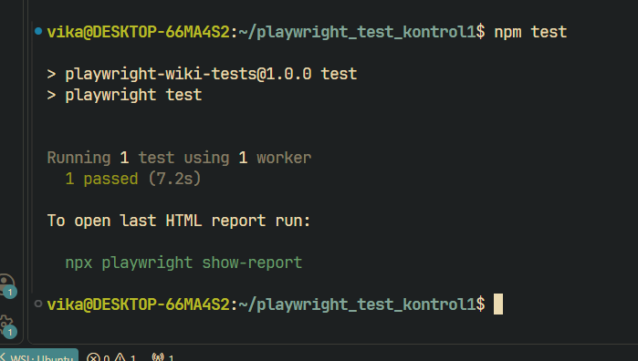

# Тестирование веб-сервиса с помощью Playwright

Учебный проект автотестов для сервиса **Русская Википедия** (https://ru.wikipedia.org).

## Что проверяет тест:
1. **Проверка текста**: открытие главной страницы и проверка приветственного заголовка.
2. **Работа с формами**: ввод поискового запроса «JavaScript» в строку поиска.
3. **Проверка текста**: корректное отображение заголовка найденной статьи.
4. **Интерактивные элементы**: клик по внутренней ссылке в статье и переход на новую страницу.

## Результаты запуска тестов



## Инструкция по запуску:

1. Клонировать репозиторий:
   ```bash
   git clone <ссылка_на_ваш_репозиторий>
   cd <папка_проекта>